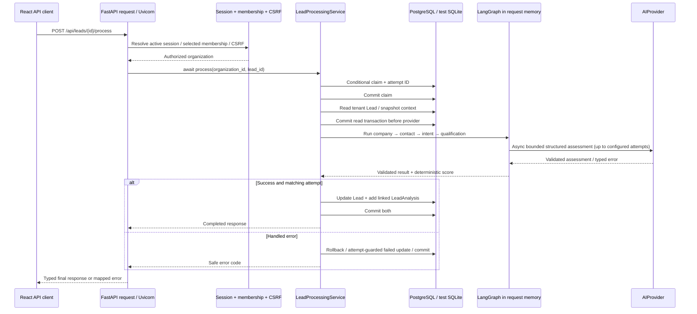

# E01 — current execution baseline

**Date:** 2026-10-12, Asia/Dhaka. **Local HEAD:** `d5ca7be212e324c68ea00dc648f54a4d3ca0a1b4`, `main`. The eight V2 baseline documents are committed locally; this task did not push them, query live Render/PostgreSQL, or execute application code. Classification below is source inspection, not a new availability benchmark.

## Baseline assumptions extracted from all eight documents

| Document | E01 assumption / constraint |
| --- | --- |
| [Masterplan](LEADFORGE_V2_MASTERPLAN.md) | Code is authoritative; retain V1 authentication/scoring/contracts; foundation before autonomous features; no architecture claim from placeholder integrations |
| [Architecture](LEADFORGE_V2_ARCHITECTURE.md) | V2-001 modular monolith/separate processes; V2-002 managed Temporal is proposed pending E01; V2-003 LangGraph reasons inside activities; V2-004 PostgreSQL owns domain authority/outbox; V2-005 all effects governed; V2-006 typed graph/structured retrieval first; V2-007 adapters; V2-008 preserve V1 APIs |
| [Domain model](LEADFORGE_V2_DOMAIN_MODEL.md) | Tenant-owned run/action/approval/evidence/usage records; no ORM access for agents; additive migrations later; engine history is not domain authority |
| [Agent architecture](LEADFORGE_V2_AGENT_ARCHITECTURE.md) | Bounded validated results, least-privilege tools, shared reservations, no direct sending, typed delegation and source-linked memory |
| [Roadmap](LEADFORGE_V2_ROADMAP.md) | E01 must assess engine/operating budget/region and gate E08; E02–E07 establish engine-independent transactions, authority, audit, cost and events |
| [Governance](LEADFORGE_V2_SECURITY_GOVERNANCE.md) | ALLOW/DENY/REQUIRE_APPROVAL, live reauthorization, immutable action hash, stop epoch, no magical exactly-once delivery |
| [UX](LEADFORGE_V2_UX_ARCHITECTURE.md) | Durable progress is a persisted projection, not streaming/spinner authority; unknown acceptance must not offer blind resend |
| [Integrations](LEADFORGE_V2_INTEGRATIONS.md) | Common adapters with provider-specific authenticity/idempotency; one timeline; OpenClaw has no database authority |

All eight working copies were read and compared with their committed contents. Original documents are unchanged. Correction proposed by E01: **Temporal remains the preferred candidate, not an accepted platform; E08 stays blocked until the feasibility gate closes.** See [ADR-001](adr/ADR-001-DURABLE-EXECUTION.md). No silent roadmap replacement.

## Precise current execution path

There is no queue/worker handoff, durable graph checkpoint, orchestration service, approval wait or provider webhook in this registered path. Async I/O does not make it background execution; the response awaits completion. Client timeout also does not prove server cancellation or rollback.

## Source evidence and classification

Paths below are relative to repository root; line numbers refer to this baseline.

| Operation | Code evidence | Classification | Crash/restart semantics |
| --- | --- | --- | --- |
| Request transport/middleware | `backend/main.py:51`, registered routers; `database/dependencies.py:6` | REQUEST_BOUND; middleware/log correlation PROCESS_LOCAL | No durable request replay; db closes on dependency cleanup |
| Regular create/list/lifecycle | `api/routes/lead_routes.py:67/90/199`; `repositories/lead_repository.py:14/134/155` | SYNCHRONOUS handlers and synchronous SQLAlchemy; REQUEST_BOUND; committed rows DATABASE_DURABLE | Completed writes persist, but response may be lost; create/lifecycle repository commits internally |
| Lead processing route | `api/routes/lead_routes.py:271` | Async I/O; REQUEST_BOUND; NOT_RESTART_SAFE as a workflow | Uvicorn loss interrupts invocation; no resume driver |
| Claim/attempt fence | `repositories/lead_processing_repository.py:20/40/56` | DATABASE_DURABLE after service commit; RESTART_SAFE records, not automatic work | Stale attempt cannot publish completion; 15-minute lease can be reclaimed only by another process request |
| Context/read transaction | `services/lead_processing_service.py:55–66` | Short service-owned transactions | Read ends before provider, avoiding lock/connection transaction across AI call |
| Graph orchestration | `ai/workflow/lead_brain_workflow.py:27/40/109` | PROCESS_LOCAL state, REQUEST_BOUND, NOT_RESTART_SAFE | `compile()` has no checkpointer; company/contact/intent outputs are lost if process dies |
| Provider retries | Same graph `_assess:42`; config bounds | PROCESS_LOCAL attempts/deadlines | `asyncio.wait_for`; retry only timeout/unavailable, configured attempts (default 2), no backoff or persisted retry schedule |
| Provider implementations | `ai/providers/base.py`, `gemini_provider.py`, `ollama_provider.py`, `router.py` | Async network; bounded structured output | Mock available without paid service; real provider selection explicit; retries may repeat billed computation |
| Score and analysis | `decision/lead_scorer.py`; `services/analysis_service.py:14`; processing completion | DATABASE_DURABLE once final transaction commits | Lead projection and linked history atomic in this service; old analysis preserved on handled failure |
| Processing failure | `services/lead_processing_service.py:86–104` | Handled ordinary exceptions update durable failure; no guaranteed crash cleanup | Hard kill or cancellation outside caught Exception can leave processing lease; failure-write error is not repaired by a sweeper |
| CSV preview/confirm | `services/lead_import_service.py:126/139` | REQUEST_BOUND; signed preview without stored job; confirm DATABASE_DURABLE | One confirm commit and nested savepoints; tenant/email unique key protects repeated duplicates, not a generic command ledger |
| Login/password/session | `authentication_service.py:69/92/128`; `auth_repository.py` | Service-owned commit/rollback; DATABASE_DURABLE | Conditional issuance/user-row guard closes stale-password race; not a durable autonomous-run principal system |
| Rate limits/log context | `core/rate_limit.py`, `logger.py`, request logging | PROCESS_LOCAL | Counters/context lost on restart and not shared across workers; logs do not establish run replay |
| Follow-up dates | `lead_repository.py:190` | DATABASE_DURABLE data, synchronous query | Date fields select rows; no timer scheduling or automatic follow-up execution |
| Scheduler/webhooks | Registered `main.py` routers and backend search | No active implementation found | No autonomous scheduler, inbound provider inbox or dispatch ledger |
| Legacy graphs/ingestion | `backend/graph/`, `workflows/`, old agents/ingestion | Competing unregistered paths, not a fallback worker | Legacy graph calls async agents from sync nodes; do not extend/import it into V2 |

`SYNCHRONOUS` describes handler/DB behavior, not durability; `DATABASE_DURABLE` describes committed facts; `RESTART_SAFE` here means a committed record persists, not that unfinished work resumes. No current business workflow qualifies as end-to-end restart-safe.

## Process/runtime map

| Surface | Repository-declared process model | Consequence |
| --- | --- | --- |
| Docker | Current uncommitted Dockerfile launches `deploy/render/runtime.py container`; explicit code copies, non-root user | One API launcher, no autonomous worker; keep unrelated Dockerfile edits unchanged |
| Runtime adapter | `deploy/render/runtime.py:91` executes Uvicorn with one worker, 30-second graceful shutdown, no proxy/access logs | Provider work shares API process; no durable shutdown handoff |
| Compose | `compose.runtime.yml`: database, one-shot Alembic gate, backend API, frontend/Nginx | Schema boot gate is not work scheduling; no engine/queue/worker declared |
| Render | `render.yaml`: two free web services, free PostgreSQL, manual deploy intent; backend `runtime.py start` | Declared staging lacks dedicated worker. Live plan/version/expiry/network conditions UNVERIFIED — REQUIRES HUMAN CONFIRMATION |
| Kubernetes | `deploy/kubernetes/backend.yaml`: one API replica, probes/security context; migration Job separate; local images/rehearsal manifests | Rehearsal topology is not production workflow/HA infrastructure |
| Tests | `tests/conftest.py` isolates SQLite/mock; `tests_postgres` separate disposable database; processing tests cover claim fences/provider transaction boundaries | Good V1 safety tests; no multi-day replay/timer/deployment workflow fixtures |
| CI | `.github/workflows/quality.yml`, `scripts/ci.py`: backend/PostgreSQL/frontend/security/container gates | No Temporal service/SDK or orchestration history-replay gate presently configured |

`requirements.txt` pins LangGraph `1.2.10` and LangGraph SDK `0.4.4`; no Temporal/Celery/Redis requirement was found. No dependencies installed in E01. New upstream APIs must not be assumed compatible with those pins.

## Crash windows and idempotency limits

Before claim commit: no saved attempt. After claim commit/before provider finish: persistent processing marker but lost graph state; repeat request after lease may rerun computation. After completion commit/before HTTP response: saved result exists although client may report failure; another processing call intentionally creates more history. Attempt fencing protects stale completion, not provider billing or generic exactly-once effects.

CSV deduplication, tenant uniqueness and guarded auth are reusable narrow safeguards. They do not authorize future external sends or deduplicate webhooks. Persisted IngestionJob model is not used as a general durable execution ledger by the registered CSV path.

E01 produced no throwaway experiment or executable contract fixtures. The [acceptance report](E01_ACCEPTANCE_REPORT.md) separates completed source/document analysis from unperformed feasibility proofs.
