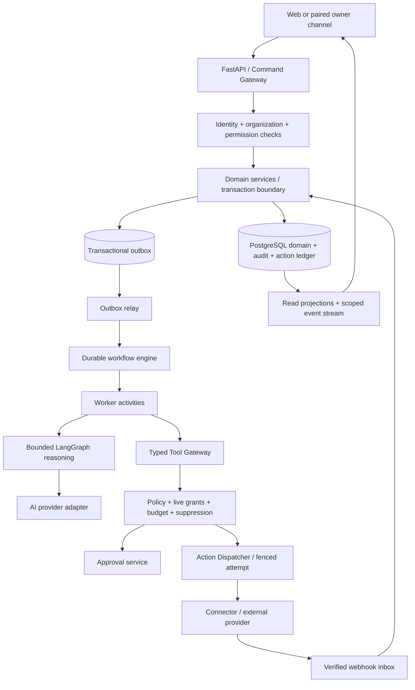

# LeadForge V2 target architecture

Proposed on 2026-10-12 against `641658e`; nothing in this document is deployed. See the [audit](LEADFORGE_V2_MASTERPLAN.md) and [implementation gates](LEADFORGE_V2_ROADMAP.md).

## Architecture decisions

| ADR | Proposed decision | Reason / boundary | Revisit trigger |
| --- | --- | --- | --- |
| V2-001 | Modular FastAPI monolith with PostgreSQL domain storage; separate worker processes and outbound gateway | Existing services can be extended; process isolation for long work without distributing every business transaction | Measured independent scaling, security or availability need |
| V2-002 | Managed Temporal is the proposed durable orchestration engine; validate hosting, cost, tenancy and operational fit in E01 before adoption | Multi-day timers, approval waits and retries should not be another ad hoc application scheduler | Failure of E01 feasibility gate requires a replacement ADR before E08; no parallel engine silently introduced |
| V2-003 | LangGraph remains bounded reasoning inside worker activities; optional durable checkpointer for multi-stage reasoning | Existing graph/validation/scorer are reusable; graph state is not action authority | Measured graphs need restart-at-stage rather than retry-whole-assessment |
| V2-004 | Domain rows, action ledger, approvals and transactional outbox live in PostgreSQL | Business invariants and event creation share one transaction | New storage only for demonstrated scale/access requirements |
| V2-005 | Every external effect uses a typed Tool Gateway and governed Action Dispatcher | Agents propose; deterministic application controls authorize and execute | Never relax for a privileged agent or owner-chat command |
| V2-006 | Typed relation tables for opportunity graph; evidence objects plus scoped retrieval first | Avoid immediate graph database/vector infrastructure and uncontrolled global memory | Measured graph traversal or semantic retrieval benefit with isolation benchmark |
| V2-007 | Provider-independent interfaces; adapters own transport, not authorization | Existing AI interface and validation can evolve | Capability mismatch requires explicit adapter capability flags |
| V2-008 | Add `/api/v2` resources without changing V1 endpoints; preserve parsed-JSON client semantics | Avoid a coordinated breaking release | Explicit deprecation/version plan only |

These are LeadForge design recommendations. Temporal separates replayed workflow tasks from activities; this informs the orchestration/activity boundary, not a claim that provider effects become exactly once. [Temporal task model](https://docs.temporal.io/tasks).

## Control and data planes



Workers receive immutable run inputs and short-lived capability references, not database credentials in prompts. Infrastructure workers can use narrowly scoped repositories; model agents cannot access ORM sessions, arbitrary SQL, shell, network URLs or raw secrets. A domain service validates both tenant and resource ownership for every operation.

Proposed modules: retain `backend/api`, `services`, `repositories`, `models`, `schemas`, `ai`. Add cohesive domains under existing layers for workflows, actions, policies, audit, usage, evidence and integrations; a module map ADR chooses names before code. Do not instantiate a competing general-purpose orchestration service in legacy `backend/graph` or `backend/workflows`.

## Durable execution objects and states

`WorkflowDefinitionVersion` describes a bounded approved plan. `WorkflowRun` identifies its tenant, initiating principal, goal/campaign, definition version, input artifact, engine ID and cancellation epoch. `AgentRun` identifies a bounded reasoning/tool invocation; a logical `Job` is an activity command, and `JobAttempt` records its lease/fencing identity, timeout, cost and result. Detailed fields are in the [domain model](LEADFORGE_V2_DOMAIN_MODEL.md).

```text
WorkflowRun: created → queued → running → waiting_approval / waiting_event / waiting_timer
                                     ↘ retry_wait → running
                                     ↘ completed / failed / cancelled
                                     ↘ reconciliation_required
Action: proposed → denied / approval_pending / authorized
        authorized → dispatching → accepted → confirmed
                           ↘ failed / delivery_unknown → reconciliation_required
Approval: pending → approved / denied / expired / invalidated
```

States are durable application projections, not synonyms for engine internals. Terminal transitions use optimistic versions. A workflow completes only when required outputs/effects meet its definition; an accepted message is not a confirmed meeting. UI streaming is a projection of persisted transitions, never the authoritative state.

## Execution lifecycle

1. API validates session or machine principal, membership, permission, schema and budget eligibility. A service writes run intent, audit and outbox event atomically; HTTP returns proposed `202` with run ID and status URL. Existing `/api/leads/{id}/process` keeps its V1 synchronous contract until an explicitly designed compatibility transition.
2. Relay claims outbox records with short database transactions and fencing. It starts/signals the engine with deterministic operation ID. Duplicate relay delivery finds the same engine workflow; no new run is created.
3. Engine selects an activity queue by work class (research, AI, dispatch, sync). Tenant concurrency and fair admission are application-controlled; provider quotas apply across every worker. A timer is engine-managed, not a sleeping HTTP request or an in-process cron daemon.
4. Activity rechecks tenant/resource scope and runs a bounded service or reasoning graph outside a long database transaction. Save validated outputs, usage and completion evidence in a short transaction.
5. A proposed effect gets an immutable ActionIntent. Dispatcher re-evaluates live authority and reserves budget; waiting approval holds no worker/database lock.
6. Verified approval event resumes the workflow by ID/version. Duplicate decisions are deduplicated. A resume does not itself grant dispatch authority; policy is checked again.
7. Accepted/confirmed provider events enter verified inbox, then update conversation and outcome projections transactionally. Completion evidence and causal IDs permit explanation.

## Retry, timeout and ambiguous-effect rules

Read-only/provider computation can retry transient 429/5xx/timeouts with bounded exponential backoff, jitter, Retry-After and per-tenant budgets. Proposed defaults for initial validation: 3 attempts, initial 2 seconds, cap 60 seconds; workflow total/provider deadlines override defaults. Authentication, malformed output, denied policy and permanent recipient errors do not auto-retry. Provider circuit breakers pause dispatch without silently switching data to a new provider.

External effects use a stable idempotency key scoped to tenant, ActionIntent and semantic effect. Persist attempt before dispatch; persist provider operation ID when known. Where the provider supports durable idempotency, reuse that key. If acceptance is unknown after a timeout, move to `delivery_unknown` and query provider/reconcile before resending. Without provider lookup/idempotency, require operator resolution. **At-least-once events plus deduplication do not guarantee exactly-once email/call delivery.**

Replay-safe workflow code contains no direct network, clock, random, database or model calls; those are activities with persisted outputs. Activity idempotency uses a unique operation key and compare-and-swap state; engine history and database writes are not one atomic transaction. An activity whose database commit succeeded but engine acknowledgment failed returns the saved result on replay.

Dead-letter records retain safe reason, schema/version, attempt IDs, evidence references and recovery owner. Re-drive is an audited command that reauthorizes effects and retains the original semantic key. Operators cannot turn a dead letter into an unreviewed new send.

## Cancellation, approval expiry and stop races

Each organization/campaign has an execution-enabled flag and monotonically increasing stop epoch. Stop revokes outstanding dispatch capabilities, invalidates queued work and signals workflows. Dispatcher checks epoch and live suppression under the same transaction that claims an action. Start/pause/resume are permissioned and audited; resume cannot bypass fresh approval or budget reservation.

There remains a boundary after a provider receives an action: cancellation cannot unsend an email or guarantee immediate call termination. Mark those effects in flight, attempt provider cancellation where available, and reconcile results. No claim of instantaneous global stop. Initial gate: new internal dispatch claims blocked immediately after committed stop; active worker acknowledgment within 5 seconds in the pilot environment, with provider-bound work explicitly visible.

## Event publishing and webhook processing

Proposed event envelope: event_id, schema_version, organization_id, aggregate_type/id/version, event_type, occurred_at UTC, correlation_id, causation_id, actor reference, payload_ref and data classification. No secret or full message content in queue envelopes. Events are published from an outbox transaction, consumed through an inbox with tenant/provider-event uniqueness, and causally ordered per aggregate version. Do not assume global event order.

Provider webhook ingress verifies signature/authentication and endpoint-to-connection binding before tenant resolution. Persist bounded raw artifact and inbox acceptance before acknowledging; process asynchronously except protocol-specific synchronous voice/control responses. Duplicate/out-of-order events follow monotonic status rules; unknown mappings quarantine. Poison payloads get bounded retries and dead letters. Backpressure returns protocol-appropriate retry responses; it never accepts a payload that was not durably stored.

## LangGraph participation and compatibility

Current `LeadBrainWorkflow` compiles without a checkpointer and runs company → contact → intent → qualification during an HTTP operation. Keep provider abstraction, validated schemas, exact supplied-field evidence checks, scorer and prior-analysis preservation. Refactor registered processing into a reusable service/activity in a later epic, not a second competing graph.

For restart-at-stage support, a scoped persistent checkpointer can hold reasoning artifacts. LangGraph separates thread checkpoints from cross-thread stores; in-memory checkpoints do not survive restart. [LangGraph persistence](https://docs.langchain.com/oss/python/langgraph/persistence). Application authorization must wrap every checkpoint read/resume; thread IDs alone are not authorization.

LangGraph interrupts can represent reasoning pauses, but app Approval records are authoritative. An interrupted node resumes from its beginning, so no external effect belongs before an interrupt without idempotent activity handling. [LangGraph interrupts](https://docs.langchain.com/oss/python/langgraph/interrupts). Pin the installed library/API version during implementation; current upstream documentation is not proof that this repository has those APIs.

Keep orchestration ownership singular: Temporal owns long timers, run scheduling and activity recovery; LangGraph owns reasoning transitions; PostgreSQL owns business facts/authority/action ledger. SDK-owned checkpoint schemas require reviewed migration integration, not production `setup()`/`create_all()` on startup.

## Revenue Brain and governed learning

Workspace Brain versions include company identity/markets, products and services, ICP and exclusion criteria, buyer personas, pain points, competitors, differentiators, pricing/currency/offer constraints, case studies, brand voice, objection handling and compliance policies. Structured approved facts and source artifacts take precedence over generated summaries. Each field/claim references USER_CONFIRMED, SYSTEM_OBSERVED, AI_INFERRED or EXTERNAL_SOURCE provenance, freshness, confidence, contradictions and rights. Missing pricing, permission or commercial authority cannot be guessed by a Copy/Voice agent.

Onboarding collects business facts, imports permitted documents, proposes extraction with evidence and requests user confirmation. Publishing a Brain version is permissioned/audited and material offer/compliance changes require review. Campaigns pin a confirmed version; urgent restrictions invalidate pending actions even when their old Brain version remains readable. Tenant-scoped retrieval filters before ranking and prompt assembly. Start with structured fields and keyword retrieval; adopt embeddings only after isolation, deletion, provenance and quality benchmarks. No global shared customer vector memory.

Revenue Autopilot uses a typed Goal, GoalPlanVersion and PortfolioAllocation rather than a natural-language loop with unrestricted tools. Example goal: 20 qualified, attended meetings from logistics companies in UAE in 30 days, under USD 2,000. Define qualification/attendance, market/legal profile, eligible channels, baseline, deadline/timezone, allocation ceilings and stop criteria first; meeting count alone does not establish revenue. The goal is illustrative and cannot activate outreach until its market/channel eligibility is approved.

Planner proposes campaign portfolio, cohort/holdout design, source coverage, expected cost range and uncertainties. Human approves plan and budget. Reserve estimated provider cost before each action across concurrent campaigns; track settled, reserved and uncertain liability, not merely billed totals. Stop new execution at the budget envelope or deadline. Permit only approved bounded optimizations (for example cadence inside a range); new offers, markets, recipients, channels or financial commitments create new governed plans.

Learning lifecycle: Observation → Hypothesis → Experiment → Evidence → Recommendation → Policy/HITL → Apply a new version. Observations link confirmed outcomes to source events and censor delayed/unknown delivery. Experiments have stable assignment, control group, primary metric, minimum sample criteria, duration and safety/budget stop. Avoid claiming causality from an observational dashboard. Recommendations expose uncertainty, exclusions and expected downside; no silent mutation of prompts, pricing, ICP, scoring weights, sequence or policies. Rollout is cohort-limited with rollback to previous version, while irreversible sends remain in history.

“Explain This” is a read service over DecisionRecord: question type, authorized subject, input snapshot/version, evidence refs, rule/scorer/model versions, policy rationale, human decision, action receipt and outcome. Hot-lead explanation shows components and supplied/inferred facts; selection explains ICP/segment/source constraints; message explanation cites Brain and prospect facts; approval explanation names matched risk/permission rules; campaign-change explanation shows experiment/recommendation/approval; action explanation shows initiator, authority and actual provider result. Explanations distinguish unknown and stale evidence and never fabricate reasoning when a record is absent.

## Reliability and deployment requirements

Separate API, activity worker, dispatcher, webhook ingress and outbox relay privileges. Start with shared code/image and independently scaled processes; isolate channel secrets to dispatch adapters. Use managed PostgreSQL, bounded pools, fair per-tenant concurrency, least privilege, offsite encrypted backup/PITR and staged restore drills. Retain current schema readiness gates and separate migration operator.

Proposed pilot SLOs for later approval: 99.9% API availability; p95 control-plane mutations under 1 second excluding external calls; runnable work admitted within 30 seconds p95; RPO ≤15 minutes and RTO ≤2 hours. Voice media needs a separate measured latency budget. No current achievement claimed. Instrument queue age, retries, approval age, cost reservations, provider health, unknown deliveries, webhook lag, stop propagation and recovery duration.

Before enabling autonomy, fault tests must kill workers before/after commit and provider acceptance, replay duplicate commands/webhooks, rotate/revoke grants mid-run, expire approvals, cancel campaigns and restore a backup. Recovery begins with outbound dispatch disabled until accepted effects are reconciled; restored jobs must not blindly replay sends.
