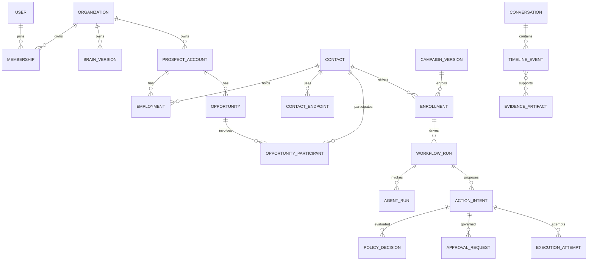

# LeadForge V2 logical domain model

Design only, audited 2026-10-12 at `641658e`. Names below are logical entities, not created tables or migrations. [Architecture](LEADFORGE_V2_ARCHITECTURE.md) defines execution; [governance](LEADFORGE_V2_SECURITY_GOVERNANCE.md) defines authority.

## Ownership invariants

User is a global login identity; Organization is the customer security/billing workspace. Prospect Account is a customer-owned company record, not a User or Organization. All business entities, including conversation memory, evidence, agent runs, embeddings, provider mappings and audit exports, carry organization_id. Reference integrity uses `(organization_id, entity_id)` pairs and tenant-scoped unique constraints where applicable. A global provider identifier never selects a tenant without a registered IntegrationConnection mapping.

One domain owns each aggregate's writes. Other domains call services or consume events; they do not directly mutate another domain's ORM tables. Cross-domain command writes use a service-owned transaction/unit of work when local and an outbox/compensating workflow when external. Version and state transitions are validated before commit. Agents have no direct database ownership.

## Domain inventory

| Domain | Owning aggregates / essential fields | Relationships and write boundary | Existing anchor |
| --- | --- | --- | --- |
| Identity | User, AuthSession; future AccountRecovery, MFAEnrollment, ExternalIdentity, ServicePrincipal, CapabilityGrant | Sessions belong to User; machine principal binds an Organization and narrow grants; global identity data never becomes prospect data | Existing User/session/password services |
| Organizations | Organization, Membership, Invitation, WorkspaceSetting | Active membership grants scoped permissions; invitations bind normalized intended identity, role, expiry and single-use redemption | Existing organization/membership |
| Subscriptions | Subscription, PlanVersion, Entitlement, BillingEvent | Organization owns subscription; immutable billing inbox drives entitlements; do not read `Organization.plan` as execution authority | Existing plan string only |
| Business Brain | BusinessProfileVersion, Product/Service, ICPVersion, Persona, Market, Positioning, BrandPolicy | Organization-owned versioned knowledge; approved versions feed campaign/agent snapshots; evidence links below | Missing |
| Accounts | ProspectAccount, AccountAlias, DomainIdentity | Organization-specific company identity; many Contacts and Opportunities; merges preserve aliases and lineage | Lead.company string |
| Contacts | Contact, ContactEndpoint, Employment, IdentityAlias, PermissionBasis | Person may work at multiple Accounts over time; endpoints have verification/suppression states; cross-org contacts remain separate | Lead.email string |
| Lead Intelligence | LeadCandidate, QualificationVersion, LeadAnalysis, ScoreProjection | V1 Lead remains compatible candidate record; links to Account/Contact; assessments version inputs/scorer and evidence | Existing Lead/LeadAnalysis |
| Signals | SignalObservation, SignalDefinition, MonitoringSubscription | Account/Contact/Opportunity subject, source, observed_at, expires_at, event dedupe key; no inference presented as observed intent | Missing |
| Evidence / Provenance | EvidenceArtifact, Claim, ClaimEvidenceLink, SourceLicense, FactRevision | Many claims reference artifacts; evidence owner validates provenance and access; immutable revisions supersede, not overwrite | Existing bounded analysis JSON evidence |
| Opportunity Graph | Opportunity, OpportunityParticipant, RelationshipEdge, OpportunityAssessment | Account linked buying committee, stage, amount/currency, estimated close, hypothesis and supporting evidence; typed edges scoped to org | No persisted opportunity entity |
| Campaigns | CampaignVersion, SegmentDefinition, SegmentSnapshot, Enrollment | Organization campaign references Brain/ICP/policy versions, budget and channel; segment freezes enrollment facts | Missing |
| Sequences | SequenceVersion, StepDefinition, TouchPlan, StepExecution | Campaign uses immutable sequence; contact enrollment advances through durable runs; touches link actions/messages/calls | Missing |
| Conversations | Conversation, Participant, TimelineEvent, RelationshipSummaryVersion | One relationship timeline over multiple channels; summaries derived from source events; channel threads map into same tenant conversation | Missing |
| Messages | MessageDraftVersion, Message, DeliveryAttempt, DeliveryEvent | Conversation owns context; Message service owns content/dispatch status; action ledger owns authority and attempt dedupe | Missing |
| Calls | CallPlan, Call, CallLeg, TranscriptArtifact, CallOutcome | Conversation links call/media/provider IDs; participant, recording/disclosure permissions and transfer status explicit | Missing |
| Meetings | MeetingProposal, Meeting, CalendarBooking, AttendanceOutcome | Opportunity/Conversation relationships; provider event/timezone metadata; booking effects require action authorization | V1 lifecycle Meeting label only |
| Approvals | ApprovalRequest, ApprovalDecision | Binds exact ActionIntent hash, requested approvers, reason/evidence, risk, expiry; approve/deny decisions immutable | Missing |
| Policies | PolicySetVersion, PolicyRule, PolicyDecision, StopControl | Organization owns rules; campaign-specific tightening allowed; platform hard deny cannot be overridden by tenant or AI | Missing |
| Agent Runs | AgentDefinitionVersion, AgentRun, ToolInvocation | Bounded agent context, scope, provider/model/prompt version, outputs, cost, trace, failure; no unrestricted tools | Legacy agents not this domain |
| Workflow Runs | WorkflowDefinitionVersion, WorkflowRun, Job, JobAttempt, Schedule | Durable engine ID, status/version, tenant, principal, stop epoch, activity state and checkpoint refs | Lead lease is a narrower precursor |
| Integrations | IntegrationConnection, CredentialRef, ProviderObjectMapping, WebhookInbox, SyncCursor | Owner identity, org, scopes, grant/expiry, capability and health; no raw token in public schemas/events | Empty package |
| Notifications | Notification, NotificationPreference, DeliveryReceipt | Recipient must still be authorized for linked resource; notification content redacted by channel | Missing |
| Audit | AuditEvent, AuditExport, IntegrityBatch | Append actor/action/resource/policy/evidence/result/correlation; audit writer separate from logger | Diagnostic logging only |
| Usage | UsageReservation, UsageEntry, Budget, QuotaWindow | Organization/campaign/goal budget; reserve estimated upper bound atomically; settle/reconcile actual usage | Plan/lead-limit fields without ledger |
| Goals | RevenueGoal, GoalPlanVersion, PortfolioAllocation | Organization outcome, time, cost, markets and forbidden actions; human approves goal/plan versions | Missing |
| Experiments | ExperimentVersion, Assignment, Observation, Hypothesis, Recommendation | Goal/campaign cohorts, holdout, metrics and evidence; recommendation requires policy before applying new version | Missing |
| Revenue Analytics | OutcomeEvent, MetricDefinitionVersion, AttributionProjection, ForecastSnapshot | Derived from meetings/opportunities/messages/cost; source event/definition versions; no implied causal revenue | Existing dashboard/report aggregates |

Infrastructure supports ActionIntent/ExecutionLedger, Outbox and Inbox; these are not arbitrary generic JSON CRUD resources. They have constrained schemas and unique operation keys. Suppression/consent records are owned by governance/contact permissions and shared through a deterministic eligibility service, not duplicated in each campaign.

## Relationship map

All business relationships in this conceptual diagram additionally carry the Organization boundary. Cardinalities describe allowed relationships, not authorization rules. Contact-to-conversation participation and evidence links are explicit join records in the physical design.

## Shared contracts

**ActionIntent:** ID, organization, originating principal/run, action type, channel, target resource/endpoint, exact content artifact hash/version, provider connection, estimated cost/currency ceiling, allowed execution window, policy evaluation refs, idempotency key, version and execution state. Immutable executable payload; edits create a new intent/version and invalidate approval.

**ApprovalRequest:** request ID, tenant, requester, proposed action hash, reason, structured evidence refs, risk/confidence snapshot, relevant policy version, approver eligibility/required quorum, requested_at, expires_at, decision records with approver/time, and execution_status projection. Decision and execution are separate; approved does not mean sent. New risks or role changes require re-evaluation.

**Evidence/claim:** subject, predicate/value/unit, provenance category, source artifact/content hash, source publisher/provider, locator, observed_at/acquired_at/valid_until, rights/license, confidence/evaluation version, verification state and contradiction links. Categories: USER_CONFIRMED, SYSTEM_OBSERVED, AI_INFERRED, EXTERNAL_SOURCE. Categories are origin; confirmation/validity are separate fields. Human confirming an external claim creates a confirmed revision retaining the original source.

**Run envelope:** organization, user/machine actor, capability grant version, workflow/agent/action IDs, definition/prompt/model/tool versions, input artifact hashes, trace/correlation/causation, deadline, reserved budget, checkpoint reference and stop epoch. Queue messages use envelope references rather than raw PII.

**Timeline event:** tenant, conversation, participant, channel, direction, provider event ID, event type, occurred_at, ingested_at, body/media reference, consent classification, causal action/message/call/meeting IDs, supersession/deletion state. Timeline ordering uses occurred_at plus stable ingestion tie-breaker; late events remain visible as late.

## Incremental migration strategy

Keep V1 integer IDs and contracts. New entities may use opaque IDs, but tenant scope remains mandatory even with unguessable identifiers. Do not force a global ID rewrite. New timestamps use timezone-aware UTC with explicit compatibility conversion for V1 naive UTC; do not reinterpret historical values in place.

Normalize Account/Contact additively: stage deterministic candidate links, preserve original Lead company/email/source, expose uncertain matches for review, and backfill in bounded tenant batches. A shared domain or same email is a candidate, not automatic identity proof. Never merge customer data across organizations. Reversible aliases/merge lineage permit correction; suppression history survives merges.

New composite foreign keys, unique `(organization_id, provider, connection_id, external_id)` mappings and versioned indexes require independently reviewed Alembic migrations. Subscription/usage expansion cannot assume historical plan strings imply paid entitlements. Legacy unlinked analyses remain history rather than guessed lead links.

High-volume artifacts (message bodies, transcripts, source captures) belong in encrypted object storage with tenant-scoped metadata and expiring signed access; structured facts remain PostgreSQL. Search/vector projections are rebuildable and permission-filtered. Deletion cascades require a retention/hold plan; never cascade-delete audit authority without considering pseudonymization and legal holds.

Future migration gates: clean install, representative populated upgrades, two-tenant FK attack tests, unique/idempotency races on PostgreSQL, bounded backfill retry, index/query plans, no secret defaults, V1 API parity, restore-at-new-schema rehearsal and forward-fix rollback plan. No physical schema or migration was generated by this planning task.
