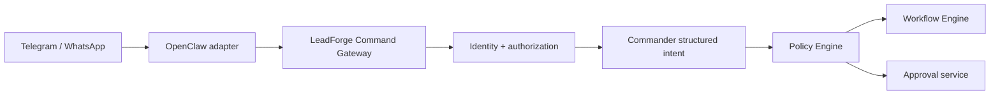

# LeadForge V2 discovery, communication and command integrations

Design only, 2026-10-12 baseline `641658e`. `backend/integrations/__init__.py` is currently empty and Settings reports CRM/automation unavailable. Configuration placeholders and runtime assets do not constitute integrations. No account/provider connection was created for this plan.

## Common adapter architecture

Each adapter implements an explicit capability registry: read/search, enrich/verify, draft, send, receive, calendar book, CRM read/write, voice initiate/transfer, reconcile and revoke. Capabilities declare schema/version, provider permission scopes, rate/cost dimensions, maximum payload, region/data processing restrictions, idempotency/lookup semantics and webhook protocol. Unavailable capabilities return typed unsupported errors rather than silently falling back.

Connection stores tenant, authorized installing identity, provider account IDs, capability grant/scopes, encrypted credential reference, health, expiry, sync cursor and version. Lifecycle: pending → connected → degraded / revoked / reconnect_required. Consent to connect does not authorize every action supported by a provider. Connector operations use typed domain services and ActionIntent for effects; adapters never make policy decisions.

Outbound contract: action/attempt ID, exact immutable payload ref, connection/version, idempotency key, deadline, stop epoch, reserved budget. Response: accepted/provider ID, definite rejection, retryable-not-accepted, or acceptance_unknown. Inbound contract: verified connection/event ID, event type/schema, occurred/ingested timestamps, payload/artifact hash, signature-validation result and resource mapping. Keep provider DTOs at adapter boundary; no provider-specific fields spread through Campaign or Conversation.

## Discovery and enrichment

```text
Approved source/ICP/market/budget
→ provider search with bounded cursor
→ staged candidate + raw evidence reference
→ tenant normalization/dedupe
→ permitted enrichment and endpoint verification
→ claims/conflicts with provenance
→ qualified candidate review
→ authorized campaign eligibility (separate decision)
```

Use licensed company/contact datasets, customer-owned CRM/import records and permitted public-source APIs. SourceContract records allowed use/retention, territory, data classes, provider terms/version and deletion restrictions. No unauthorized scraping, login bypass, CAPTCHA evasion, private data harvesting or website robots assumptions as a legal permission substitute. Do not choose a vendor until licensing, coverage, accuracy, cost and regional processing have been evaluated.

Normalize domains, names and contact endpoints conservatively. Tenant email uniqueness remains a V1 constraint; V2 endpoint/contact identity can support multiple jobs/emails with explicit mappings. Dedupe tiers: exact registered provider ID → verified domain/company identity → deterministic endpoint match → fuzzy candidate requiring review. Never merge across tenants or erase source disagreement. Verification state is deliverability/identity evidence, not marketing consent.

Monitoring subscriptions bind subject/source/signal definition, refresh schedule, budget and expiry. Webhook/poll changes produce immutable SignalObservation records; missing data and stale signals cannot imply negative facts or buying intent. Rate limits/cursors/backoff and partial-source outages preserve completed work. Source removal invalidates claims/derived projections through lineage; it does not silently delete user-confirmed business knowledge.

## Email outreach and reply ingestion

Initial release uses one provider adapter in sandbox behind the common contract. Future Gmail/Microsoft Graph or an approved sending provider require separately reviewed scopes and transport contracts; this plan does not assert interchangeable APIs. Connector E15 supplies infrastructure, not authorization to send.

CampaignVersion pins Brain, segment, sequence, offer, sender, channel, budget and policy references. Enrollment tracks contact eligibility and touch state. Touch plan generates a draft from supported claims; message content/recipient/version is frozen before policy/approval. Dispatcher checks jurisdiction, endpoint verification, suppression, sender limits, contact frequency, campaign stop, current connection scopes and reserved spend on every touch.

Message states distinguish draft, approved, dispatching, accepted, delivered, bounced, complained, failed and unknown. Preserve delivery events independently rather than losing history with status overwrite. Sender/domain reputation and warm-up are measured operational controls; no fabricated opens/clicks or volume promises. A signed unsubscribe link grants only that opt-out operation; raw PII is absent from the URL.

Verified reply ingress resolves connection/provider thread and participants to tenant Conversation. Deterministic opt-out/complaint handling precedes classification; pause automated sequence on reply before model generation. Classify intent, ambiguity, objection, interest, scheduling, out-of-office, referral and escalation with confidence. Replies can propose responses or next actions but cannot directly send, book or change prices.

Nurture uses durable timers and permitted cadence across the shared timeline. Stop conditions: opt-out, hard bounce, complaint, reply requiring human attention, meeting booked, goal/campaign pause, expired consent/window, budget exhausted. New channel or offer requires renewed policy checks. Outcomes feed versioned analytics, not uncontrolled adaptive rewriting.

## Unified customer relationship timeline

Conversation service links provider channel threads, email messages, messaging events, calls/legs, transcripts, meetings and human notes to Contact/Account/Opportunity participants. Identity resolution can be uncertain; quarantine unmatched events rather than attaching to a guessed person. One person may have separate commercial contexts; shared relationship summary explicitly names its scope and source events.

RelationshipSummaryVersion records obligations, preferences, objections, approved commercial facts, permission state and open follow-ups with evidence refs. Source events remain authoritative. Redactions/deletions propagate to summaries/checkpoints/search. Out-of-order webhooks preserve occurred_at and ingestion order. Cross-channel frequency and suppression are enforced centrally; an email opt-out cannot be automatically “worked around” by a voice or messaging agent.

## Calendar and CRM

Calendar operations expose bounded availability windows/timezones and explicit attendees. Booking is an ActionIntent with an approved proposal and conflict check. Persist provider booking ID and reconcile unknown results before retry. Do not duplicate a meeting when a callback or provider reply is delayed. Cancellation/reschedule follows the same policy path. Calendar content visibility is minimized.

CRM sync records field mapping, source-of-truth precedence, external version, origin marker and cursor. Webhooks plus scheduled reconciliation detect drift. Scope IDs by provider connection; retries use idempotent upsert where supported. Prevent echo loops and preserve conflicts for human review. Bulk overwrite/merge/delete is governed; CRM cannot silently overwrite confirmed Brain facts or clear suppression. Revocation stops writes and indicates sync freshness in UX.

## Voice: ElevenLabs and Twilio boundaries

Telephony adapter owns dialing, call legs, status callbacks, numbers, media transport, termination and human transfer. Conversation-AI adapter owns approved speaking behavior, synthesis/recognition and transcript/analysis output. Proposed pairing is Twilio telephony plus ElevenLabs conversational voice where the supported protocol, latency, region and cost tests pass; no runtime dependency has been added.

Outbound CallPlan binds participant, caller identity, approved jurisdiction/consent/recording evidence, AI disclosure text, script/version, tool allowlist, maximum duration/spend, allowed window and tested transfer destination. Calls pass the same action gateway as messages. Live agent cannot change commercial terms, access secrets or invoke unrestricted tools. Protect recordings/transcripts as sensitive artifacts, separate from operational logs.

ElevenLabs post-call webhooks support transcript/analysis integration; delivery and event shapes must be verified for the chosen SDK/API version. [ElevenLabs post-call webhooks](https://elevenlabs.io/docs/eleven-agents/workflows/post-call-webhooks). Verify authenticity before accepting transcript events, and correlate both telephony and AI conversation IDs. A post-call result may arrive after termination, duplicate or be absent; reconciliation handles each state.

Voice lifecycle: approved → queued → dialing → connected → disclosure/eligibility confirmation → active → transferring / ended → transcript_pending → summarized → follow_up_proposed. Protocol-specific synchronous callbacks must return safe approved responses quickly while durable events persist. Human transfer failure uses an approved apology/end path, not continued negotiation. Stop, user objection, disclosure failure, missing permission or budget cap ends/blocks the call. Follow-ups become new ActionIntents and never inherit unlimited call authority.

## Commander, OpenClaw and owner control



OpenClaw is an untrusted integration relative to LeadForge business authority; it receives no database credentials/access or unrestricted tenant tool. Its official security model assumes a trusted operator boundary rather than hostile multi-tenant isolation. Therefore use separately scoped gateway/credentials where trust differs, and enforce all customer isolation in LeadForge. [OpenClaw security model](https://docs.openclaw.ai/gateway/security).

ExternalIdentity pairing requires an authenticated LeadForge owner/operator session and verified chat account/channel IDs with explicit tenant grants. Phone number/display name/chat text alone is not identity. Proposed CommandEnvelope includes command ID, tenant binding, paired actor, source event ID, intent type, validated typed parameters, issued/expiry times, nonce, authentication proof and requested response channel. Replay is deduplicated; mutations get a dry-run/approval preview.

Allowed initial intents: report.read, run.status, approvals.list, approval.decide, campaign.pause, organization.stop, plan.propose. Enable start/resume/budget/integration changes only after separate grants and step-up design. Models may parse language into intents; gateway rejects unknown/ambiguous target or permission escalation. A bare “yes” must bind to one live approval/action hash and version, not the latest conversation guess.

Alerts/reports are redacted and recipient-authorized; group chats do not automatically inherit workspace access. Lost external-account access revokes bindings and queued command grants. Owner controls use the same audit/stop records as web. Messaging customers and commanding LeadForge are different permissions even when using the same provider.

## Integration acceptance gates

Each adapter needs recorded sandbox fixtures, signature-negative and replay/out-of-order tests, tenant mapping collision tests, revoked/expired scopes, refresh races, 429/backoff, malformed payloads, idempotency/unknown acceptance, cleanup/deletion, quota/cost accounting and provider outage recovery. Voice adds disclosure/transfer/latency/media disconnect tests. Chat adds identity pairing, nonce replay, ambiguous approval and permission revocation tests.

Provider purchase, OAuth account connection, legal approval, production credentials, migrations and deployment remain future separately authorized work. Release one connector/channel at a time; pass end-to-end policy gates before enabling autonomous effects.
