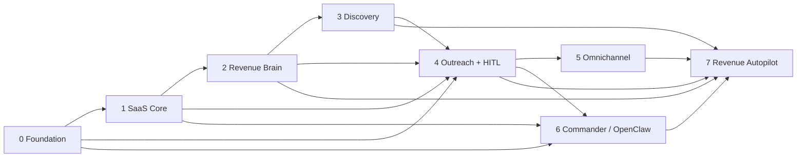

# LeadForge V2 dependency-driven release roadmap

Planning baseline: 2026-10-12, commit `641658e`. Implementation is not authorized by this document. All new module paths below are proposed; verify existing ownership before creating them. No schedules, staffing estimates or production readiness are implied.

## Program dependencies and release discipline

Read-only planning prototypes can be explored earlier in mock/shadow mode, but external effects wait for dependency gates. Pilot Autopilot may be email-only after Program 4; full omnichannel/owner-control GA waits for Programs 5–6. This exception narrows scope; it does not waive policy, budget, evidence or audit gates.

Each epic delivers one bounded vertical slice with explicit API/schema/state contracts, isolated tests and an independent review. Split an epic when it contains multiple unrelated migrations, vendors or channels. Avoid a cross-cutting “implement agents” PR. Defaults deny new external effects; rollouts use feature gates, sandbox evidence, approved cohorts and reversible configuration where possible.

Shared Definition of Done: tenant isolation and permission-negative tests; operation-owned transactions; validated structured output; no secret/content logging; mocks without paid services; PostgreSQL concurrency tests where correctness depends on locks/constraints; reviewed Alembic upgrade/backfill when schema changes; V1 API parity; frontend error/loading/access states and case-sensitive build; recovery/stop/idempotency evidence; scoped diff and release/runbook review. A plan or provider demo is not completion.

## Program 0 — V2 Foundation

**Objective:** make authority, durability, cost and audit enforceable before execution capabilities exist.

**Architecture:** ADR/module map, service-owned unit of work, immutable scoped execution context, proposed managed Temporal feasibility gate, transactional outbox/inbox, action ledger, policy/approval/stop boundaries. **Backend:** permission services, audit writer, reservations, run services/worker adapter and fenced dispatcher contract; no provider send. **Frontend:** read-only run/approval/stop projections and safe command receipt UX in fixture mode. **Data:** additive grants, audit, usage, event, run, intent, policy, approval and stop objects in independent migrations. **Security:** fail-closed effects, revocation, tenant scope across workers, separation of duties and limits.

**Tests:** two-tenant attacks, lost/double acknowledgments, worker death, approval replay, budget races, stop-at-dispatch, ambiguous effect simulator. **Acceptance gate:** synthetic proposal → approval → mock effect → receipt survives process restart without duplicate semantic effect, respects revoked permission/suppression/stop and has complete audit/cost lineage. **Dependencies:** V1 baseline and E01 ADR approval. **Risks:** custom-engine creep, dual state ownership, retry TOCTOU, unsafe repository commits. **DoD:** shared DoD plus E01–E12 gates; no real channel is enabled.

Epics: E01 decision/baseline; E02 transaction ownership; E03 principal context; E04 permissions; E05 audit; E06 reservations; E07 events; E08 durable runs; E09 action ledger; E10 policy; E11 approval; E12 stop. Exact boundaries at document end.

## Program 1 — SaaS Core

**Objective:** real account/workspace lifecycle, entitlements and operational isolation.

**Architecture:** retain first-party browser sessions, introduce governed invites/recovery, secure integration grants and commercial control separate from safety. **Backend:** invites/members/admin commands, verified recovery/email flow, scoped connections, subscription entitlement service, shared abuse budgets, Account/Contact normalization. **Frontend:** onboarding/workspace members, account recovery, connection health, billing status and contact/account review. **Data:** invitations/recovery challenges, subscription/billing inbox, connection/token refs, normalized contacts/accounts/aliases and reversible links. **Security:** owner/admin boundaries, single-use identity challenges, OAuth grant minimization, secret vault and tenant exports/deletion.

**Tests:** expired/replayed invites and recovery, privilege escalation, revoked connections, billing event duplicates, quota races, tenant identity collisions, populated backfill and rollback. **Acceptance gate:** two independent organizations onboard/manage members/connect sandbox accounts without cross-access; entitlements cannot bypass governance; existing login/change-password remains compatible. **Dependencies:** Program 0. **Risks:** account takeover, billing/safety coupling, accidental cross-tenant dedupe, irreversible backfill. **DoD:** shared DoD, operator recovery/PITR rehearsal, explicit security/legal owners.

Small epics: E13 invitations; E14 recovery lifecycle; E15 connection framework; S04 one billing provider inbox/read-only entitlements; S05 atomic commercial quota enforcement; S06 shared authentication/API abuse budgets; S07 additive Account/Contact records; S08 tenant-batch Lead links and reversible match review; S09 retention/export/deletion pilot; S10 MFA/step-up slice. Do not ship every identity enhancement in one epic.

## Program 2 — Revenue Brain

**Objective:** workspace understanding, evidence-backed qualification/opportunities and reusable explanation.

**Architecture:** versioned facts/claims, source provenance, tenant retrieval, approved Brain snapshots and typed graph relations. **Backend:** Brain publishing/revisions, artifact ingestion, claim conflict service, intelligence activity wrapper, opportunity participants, Explain This read service. **Frontend:** Brain editor/review, evidence freshness/contradictions, Accounts/Opportunities and explanations. **Data:** Brain/ICP/persona/offer versions, evidence/claims, opportunity edges/participants/assessments; preserve V1 Lead/analysis. **Security:** prompt-injection boundaries, artifact permissions, confirmed-fact ownership, immutable strategy versions.

**Tests:** unsupported model claims, source mismatches, deletion propagation, confirmed/inferred category separation, retrieval tenant leakage and deterministic score compatibility. **Acceptance gate:** selected prospect/message/next-action rationale cites authorized versioned facts and unknowns; no real discovery/outreach required. **Dependencies:** Program 0 plus Program 1 account/contact/artifact/governance foundations. **Risks:** treating hallucinations as knowledge, stale facts, semantic retrieval leakage and graph over-engineering. **DoD:** shared DoD plus evidence/Explain This evaluations.

Small epics: B01 claim/evidence records; B02 Brain fact editor and publish version; B03 one permitted document extraction path with review; B04 ICP/persona versions and exclusion rules; B05 V1 Lead Brain worker wrapper with contract parity; B06 opportunity/participant read model; B07 reusable decision explanations; B08 scoped retrieval benchmark before embedding decision.

## Program 3 — Discovery Engine

**Objective:** provider-independent, licensed candidate acquisition, enrichment/verification and monitoring.

**Architecture:** SourceContract and capability adapters, durable search cursor, staged candidate review, conservative dedupe and signal freshness. **Backend:** one search adapter, enrichment adapter, endpoint verification, match proposals, monitored source events. **Frontend:** Discovery source health/runs/candidates/conflicts and Signals. **Data:** source license/cursor, candidate/provenance, match/verification records and observations. **Security:** source rights, permitted use/region, SSRF/egress, source budget and PII minimization.

**Tests:** duplicate pages, partial-source outages, cursor restart, source withdrawal, cross-tenant provider-ID collisions, stale/forged signal and provider cost limits. **Acceptance gate:** approved ICP/source produces explainable deduplicated candidates with explicit unknowns; no discovery result grants communication permission. **Dependencies:** Programs 0–2 and connector framework. **Risks:** unauthorized acquisition, inaccurate person mapping, provider lock-in and cost runaway. **DoD:** shared DoD, licensing/retention review and bounded pilot coverage measurement.

Small epics: D01 SourceContract/readiness UI; D02 one licensed company search sandbox; D03 contact enrichment/verification sandbox; D04 staged dedupe review; D05 one monitoring/signal adapter; D06 quotas and freshness dashboards; D07 second adapter conformance proving independence.

## Program 4 — Outreach OS + HITL

**Objective:** governed email campaign/sequence execution with replies, suppression, nurture and outcomes.

**Architecture:** immutable campaign/sequence/content versions, shared timeline, central eligibility, guarded action ledger and provider reconciliation. **Backend:** campaigns/enrollments/timers, draft generation, one email send/receive adapter, unsubscribe/bounce/complaint processing, reply classification and stop-on-reply. **Frontend:** campaign editor/preview, approvals, touch progress, conversations and unknown-delivery review. **Data:** campaigns/sequences/touches, messages/events/timeline, suppression and reply outcomes. **Security:** legal profiles, frequency/sender budgets, exact payload approval, sender identity and no channel bypass.

**Tests:** opt-out immediately before dispatch, duplicate send receipt/webhook, lost acceptance, invalidated approval, provider outage, stop/resume, reply pause and irreversible-action UI. **Acceptance gate:** a small approved sandbox cohort completes without unauthorized send; all opt-outs/complaints block future relevant touches; ambiguous acceptance never auto-resends. **Dependencies:** Programs 0–3; governance/connector/Brain/evidence gates. **Risks:** reputation damage, consent gaps, unknown delivery, hallucinated commitments. **DoD:** shared DoD, legal/channel approval, kill-switch drill and supervised pilot outcome evidence.

Small epics: O01 timeline core/human notes; O02 campaigns/segments snapshot; O03 sequence/touch scheduling in shadow; O04 draft/evidence review; O05 suppression/unsubscribe/bounce inbox; O06 single email dispatch sandbox; O07 provider reconciliation; O08 reply ingest/classify/pause; O09 bounded nurture; O10 outcome metric definitions. Suppression precedes live sends.

## Program 5 — Omnichannel Revenue Agents

**Objective:** unified relationships across calendar, CRM, messaging and governed voice.

**Architecture:** common provider capabilities/event mapping, channel-independent conversation memory and separate telephony/media execution. **Backend:** one calendar connector, one CRM connector, messaging ingress/dispatch, Twilio/ElevenLabs call/transfer/transcript adapters. **Frontend:** relationship timeline, channel eligibility, booking/sync conflict review and live call status. **Data:** provider mappings/cursors, meetings, calls/legs/transcript refs, endpoint permission profiles. **Security:** channel/legal eligibility, OAuth scopes, webhook signatures, recording/disclosure/transfer and PII retention.

**Tests:** calendar unknown booking/conflict, CRM echo/overwrite, channel identity collisions, messaging permission revoke, voice disclosure failure, transfer failure, reconnect/late transcript and cross-channel opt-out. **Acceptance gate:** each channel independently passes sandbox policy/recovery gates; transcript/meeting/CRM effects enter the same timeline with evidence and audit. **Dependencies:** Program 4 and channel-specific legal/provider approval. **Risks:** recording/voice legality, latency, sensitive data, duplicate bookings and conflicting CRM authority. **DoD:** shared DoD plus channel runbooks, incident drill and supervised rollout for each adapter.

Small epics: C01 calendar availability/proposals; C02 guarded booking/reconciliation; C03 CRM read/cursor; C04 governed field sync/conflicts; C05 one approved messaging adapter; C06 voice consent/CallPlan; C07 telephony dispatch/status sandbox; C08 conversational voice/media sandbox; C09 transfer/disclosure safety; C10 post-call evidence/follow-up proposals. Voice follows consent and transfer gates, not merely SDK connectivity.

## Program 6 — LeadForge Commander / OpenClaw

**Objective:** owners operate through authorized structured commands and paired chat identities.

**Architecture:** Command Gateway, external identity bindings, intent schema and command receipts; OpenClaw is an adapter outside tenant authority. **Backend:** pairing/grants, read commands, approval callbacks, pause/stop, high-impact step-up and alerts. **Frontend:** binding/revocation controls, command history and review handoff. **Data:** ExternalIdentity, CommandReceipt, nonce/dedupe and notification preferences. **Security:** no direct DB/tool credentials for OpenClaw; live principal scope, replay prevention, ambiguous intent rejection and group-chat minimization.

**Tests:** forged sender, revoked binding, replay callback, “yes” without exact approval binding, cross-tenant command, prompt injection and owner stop propagation. **Acceptance gate:** authorized chat read/status/approval/stop uses the same audited web policy services; unauthorized commands cause no effects. **Dependencies:** Programs 0–1 and Program 4 approval/action semantics; customer messaging transport is not itself command authorization. **Risks:** compromised chat identity/gateway, misparsed targets, broad bot credentials. **DoD:** shared DoD and isolated gateway trust/step-up review.

Small epics: M01 command schema and read gateway; M02 authenticated pairing/revocation; M03 OpenClaw read adapter; M04 Telegram callbacks; M05 WhatsApp callbacks; M06 approval binding/web handoff; M07 protective pause/stop; M08 scoped alerts/reports. Start/resume/budget changes are a separate reviewed capability.

## Program 7 — Revenue Autopilot

**Objective:** approved goals drive bounded plans, campaigns, measurement and governed learning.

**Architecture:** goal/plan/portfolio snapshots, atomic budget allocation, experiment/holdout and recommendation lifecycle; no uncontrolled self-modifying strategy. **Backend:** goal planning, portfolio reservations, objective/stop evaluation, experiment assignment, attribution/forecast and proposed optimization. **Frontend:** Mission Control goals/spend, experiments, recommendations and approval/rollback visibility. **Data:** goals/plans/allocations, experiments/assignments/observations, outcomes and metric/model versions. **Security:** goal caps/deadlines, approved markets/channels, live policy for every effect, learning/prompt/version controls and evidence rights.

**Tests:** concurrent portfolio overspend, delayed/unknown outcomes, biased assignments, unavailable channel/source, revoked plan, invalid market, stale recommendations, rollback and no silent strategy mutation. **Acceptance gate:** shadow then supervised limited goal achieves explainable progress under an approved cost/channel envelope, handles failure/stop and keeps prior versions reproducible. **Dependencies:** Programs 0–4 for narrow email pilot; Programs 5–6 for full product scope. **Risks:** incentive gaming, misleading attribution, spend escalation and harmful feedback loops. **DoD:** shared DoD, evaluated recommendation uncertainty, owner-approved cohort/experiment and safety metrics with measured rollback.

Small epics: A01 Goal constraints/editor; A02 portfolio planner in shadow; A03 allocations/reservations; A04 verified meeting/outcome definitions; A05 observation/hypothesis/experiment assignment; A06 evidence/recommendation reviews; A07 permitted bounded optimizations; A08 pilot Autopilot orchestration; A09 causal/attribution evaluation and uncertainty; A10 multilingual/channel expansion only after repeated independent gates.

## First 15 recommended implementation epics — exact execution order

Execute this order; dependencies below never point forward. All changes remain future work. “Migration expected” means a likely future Alembic change, not permission to create one now. A failed architectural feasibility gate stops dependent epics for review rather than inviting an unplanned parallel stack.

| Order / Epic ID | Name and goal | Dependencies | Primary likely files/modules | Migration expected? | Risk | Acceptance gate |
| --- | --- | --- | --- | --- | --- | --- |
| 1 / E01 | Baseline and execution ADR: reconcile active/legacy paths, contracts and managed Temporal feasibility with operating budget/region | Reviewed V1 baseline | `docs/v2/`, `docs/ARCHITECTURE.md`, dependency map for `backend/main.py`, `scripts/ci.py` | No | Medium | Approved module/engine/version ownership ADR, caller inventory, V1 contract fixtures and explicit go/no-go for E08 |
| 2 / E02 | Service-owned transactions: remove internal commit dependency from one Lead create/lifecycle slice while preserving API | E01 | `backend/services/lead_service.py`, `lead_lifecycle_service.py`, `repositories/lead_repository.py`, focused tests | No | High | Multi-write rollback and duplicate-race tests pass; V1 create/lifecycle contracts unchanged |
| 3 / E03 | Scoped execution principal: immutable tenant/user/machine context for commands and worker inputs | E02 | `backend/api/dependencies/`, `services/organization_authorization_service.py`, new principal schemas/repository/model, tests | Yes | High | No caller-selected authority; two-tenant command/worker negative tests and expired/revoked grant tests pass |
| 4 / E04 | Action permission matrix: enforce capabilities for membership and machine principals | E03 | authorization services/dependencies, membership repository, permission schema/model, `tests/security/` | Yes | High | Owner/admin/member compatibility plus deny-by-default per-action tests; no role escalation or agent grant widening |
| 5 / E05 | Audit ledger: append domain decision/transition events in the operation transaction | E03, E04 | proposed audit model/repository/service, `backend/core/logger.py` boundary, tests | Yes | High | Audit+mutation atomicity, tenant-scoped read/export, safe fields and protected writer tests |
| 6 / E06 | Usage reservations: tenant/campaign budget reserve/settle/reconcile core without billing vendor | E02, E05 | proposed usage model/repository/service/schemas, `tests_postgres/` | Yes | High | Parallel reservations never exceed ceiling; unknown liability retained; retry/settlement idempotent |
| 7 / E07 | Transactional outbox/inbox: durable event publish and consumer dedupe | E02, E03, E05 | proposed event models/repositories/services, relay entry point, tests | Yes | High | Kill-before/after-publish and duplicate-delivery tests; no event without domain commit, no cross-tenant consume |
| 8 / E08 | Durable run skeleton: approved engine adapter, one mock activity, timer and cancellation projection | E01 feasibility, E03, E06, E07 | proposed workflow models/schemas/services, worker/engine adapter, isolated infrastructure tests | Yes | High | Restart/replay/timer recovery, scoped status, code-version compatibility and one logical completion |
| 9 / E09 | ActionIntent and effect ledger: immutable proposal, fenced attempt and mock provider reconciliation | E04, E05, E06, E08 | proposed actions models/repository/service/tool-gateway schemas, tests | Yes | Critical | Competing workers produce one semantic mock effect; timeout-after-accept becomes unknown, not resend |
| 10 / E10 | Deterministic policy evaluator: ALLOW/DENY/REQUIRE_APPROVAL and versioned context | E04, E06, E09 | proposed policy models/service/schemas, permissions/eligibility boundary, tests | Yes | Critical | Deny precedence; missing jurisdiction/suppression facts fail closed; reproducible decisions with no model authority |
| 11 / E11 | Approval request/decision core: exact payload binding, expiry, eligibility and replay-safe resume | E05, E07, E08, E10 | proposed approval model/repository/service/routes, minimal approval view, tests | Yes | Critical | Wrong approver, self-approval where prohibited, changed payload, expiry/replay/revoked role all reject effects |
| 12 / E12 | Organization stop/campaign pause: stop epoch, revocation propagation and in-flight visibility | E08, E09, E10, E11 | stop control model/service, workflow/dispatcher boundaries, stop/status UI, tests | Yes | Critical | Committed stop blocks new claims, active workers acknowledge within pilot target; irreversible provider state exposed |
| 13 / E13 | Workspace invitation lifecycle: explicit role grant, expiry and single-use redemption | E04, E05 | organization routes/services, membership/invitation models/repository, onboarding view, tests | Yes | High | No default tenant, replay or unintended role grant; active membership and owner administration tested |
| 14 / E14 | Account recovery/verified lifecycle: first-party single-use challenge and session invalidation | E05, E13 | existing auth service/routes, new challenge model/repository, recovery UI, safe notification adapter, tests | Yes | Critical | Generic enumeration-safe errors; bounded attempts/expiry/replay, guarded issuance and password-change regression pass |
| 15 / E15 | Secure connector framework: credential refs, scoped OAuth grants, verified webhook inbox and mock adapter | E06, E07, E09, E10, E12, E14 | `backend/integrations/`, connection model/repository/service, callback/webhook schemas/routes, integration health UI, tests | Yes | Critical | No token disclosure or scope widening; forged/replayed webhook and refresh races rejected; revocation blocks mock external effects |
