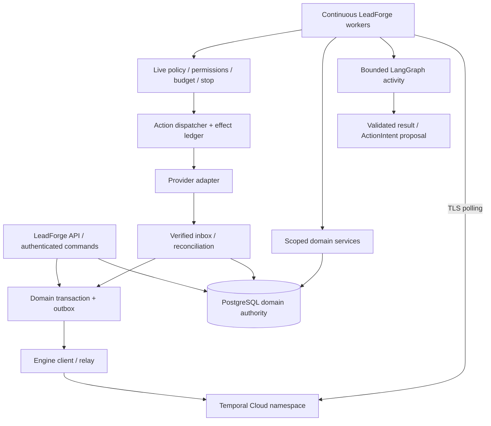

# ADR-001 — LeadForge durable execution boundary and engine feasibility

**Status:** proposed; analysis complete, platform acceptance deferred.
**Date:** 2026-10-12 (Asia/Dhaka).
**Decision identifier:** DEFER_DECISION_PENDING_FEASIBILITY_SPIKE.
**Baseline:** local `d5ca7be212e324c68ea00dc648f54a4d3ca0a1b4`; published application baseline `641658e`. No implementation or cloud-resource authorization.

## Context

LeadForge targets human-governed autonomous revenue operations spanning minutes to weeks. A process must discover/research, propose actions, wait for humans/timers/replies, recover, obey stop/permissions and explain effects. Durable execution must be distinct from bounded model reasoning. The original [V2 architecture](../LEADFORGE_V2_ARCHITECTURE.md) proposed Temporal conditionally; E01 evaluates that proposal rather than adopting it by name.

Sources are the dated [verified source register](../E01_EXECUTION_DECISION_MATRIX.md#verified-source-register). Platform facts below carry its IDs with direct supporting links. Remaining customer-specific facts are explicitly UNVERIFIED — REQUIRES HUMAN CONFIRMATION. No claim of connectivity, SDK compatibility, cost approval or live plan was inferred from public documentation.

## Current architecture

The [baseline](../E01_EXECUTION_BASELINE.md) shows an HTTP-awaited async Lead Brain operation. Service commits a tenant Lead claim, closes context read, invokes in-memory LangGraph and commits Lead/analysis together; failures can mark the matching attempt failed. There is no durable queue, timer, webhook inbox, worker or graph checkpoint. A hard crash leaves a saved processing marker; lease reclaim requires another request and reruns reasoning rather than resuming it. Some Lead repositories commit internally. Async does not imply restart-safe business execution.

## Requirements

The [requirements matrix](../E01_EXECUTION_DECISION_MATRIX.md#leadforge-requirements-matrix) covers crash/deployment durability, multi-day waits, timers/retries/timeouts, branches/parallel/child work, approval/expiry/version binding, stop, idempotent effects, tenant principals, audit/metrics, local/CI/DR and fixed/usage/engineering cost. P0 effect gates apply to every option. “Send exactly one email” means one approved semantic effect with reconciliation and provider guarantees where available; neither workflow history nor row locks eliminate provider acceptance ambiguity.

## Options considered

| Option | Finding |
| --- | --- |
| A — Temporal Cloud | Preferred target candidate: managed engine, separate Python workers; continuous-host/network/cost/version/privacy proof outstanding |
| B — self-hosted Temporal | Comparable execution model, materially more service/persistence/upgrade/on-call work; no funded platform owner/topology established |
| C — custom PostgreSQL engine | Credible limited state machine, but full multi-week orchestration introduces substantial scheduler/fencing/versioning/DR responsibilities |
| D — Celery/RQ-style workers | Good bounded jobs, not a complete durable business process; application approval/run/history/schedule/effect state still needed |
| E — current request-bound LangGraph | Retain V1 reasoning path; reject as multi-day autonomous execution backend |

## Decision matrix

Weights: durability/control 20%, HITL 10%, business-effect safety 12%, versioning 10%, observability/recovery 8%, tenant/security 10%, operations 12%, early-stage cost 10%, ecosystem 8%. Scores /5: A **4.46**, B **4.04**, C **3.00**, D **2.98**, E **2.16**. [Full scoring, capability comparison and sensitivity](../E01_EXECUTION_DECISION_MATRIX.md). Scores are judgments, not a benchmark. Required feasibility gates override the ranking.

## Decision and why

**DEFER_DECISION_PENDING_FEASIBILITY_SPIKE.** Preserve A as preferred candidate; do not select C/D merely to avoid a Cloud decision, and do not deploy A to make the ADR appear accepted. No E08 engine implementation may proceed until a successor/updated decision records the specified evidence and owner approval.

Verified Render worker plans do not include a free worker tier [R3](https://render.com/docs/compute-plans); the current repository declares free web services and no worker. Free web idle/restart limits make that declared topology unsuitable for continuous autonomous execution [R1](https://render.com/docs/free). The actual live account plan, worker funding, Cloud region/residency, SDK feature selection and egress connectivity are unproven. Public Temporal support pricing is not an approved LeadForge operating budget [T9](https://docs.temporal.io/cloud/pricing).

### Explicit baseline clarification

V2-002 remains a *proposal*, not ACCEPT_TEMPORAL_CLOUD. E01's original “go/no-go for E08” is currently no-go pending proof. Engine-independent E02–E07 design can remain in order after architecture review and separate implementation authorization. The original eight documents are not modified; the present ADR records the correction openly.

## Rejected alternatives

E is disqualified by source evidence: no durable waits/restart driver. D alone is disqualified as full orchestration; adding application timers, approval state/versioning/history makes it a hybrid closer to C. C and B are not technically impossible; neither is accepted now. B would require a staffed platform/persistence/DR plan; C is a future fallback only under explicit limited scope and a separate acceptance decision. No Redis/server/worker is created by this ADR.

## Conditional target topology

Cloud hosts orchestration, not LeadForge application workers. Python client/worker uses the documented namespace endpoint/TLS authentication [T3](https://docs.temporal.io/develop/python/client/temporal-client). Workers need outbound connectivity to that service and approved domain/provider dependencies, not inbound Cloud callbacks. Private connectivity, region and network choices require validation [T4](https://docs.temporal.io/cloud/connectivity).

## Temporal feasibility answers

| Question | Conditional LeadForge design / proof still needed |
| --- | --- |
| 1. Worker location | Dedicated paid Render background worker or approved continuously running host; future Kubernetes deployment. No worker in idle free web/API process. Selected host is UNVERIFIED |
| 2. Worker authentication | Scoped service-account API key with TLS, or mTLS certificate/private key; assess exact principal/namespace access and rotation [T3/T5] |
| 3. Secrets | Engine credential, scoped domain DB credential, authorized provider credential references, optional payload-codec key. Stored in approved secret system, never histories/prompts/logs |
| 4. API restart | Domain intent/outbox persists; relay retries same logical start/message. API availability affects new commands, not already accepted engine history |
| 5. Worker restart | Engine history can replay on compatible worker; in-flight activities may retry. Lost provider acceptance still requires ledger reconciliation [T1/T2] |
| 6. Deployment | Drain pollers/activities, retain compatible old worker version, route new runs to approved version; no live-history code mutation [T6] |
| 7. Seven-day pause | Durable wait/history, no sleeping request; expiry deadline set; offline worker delays processing when timer/message becomes runnable [T1/T10] |
| 8. Approval resume | Commit approval+outbox first, relay durable message to run; activity revalidates live authorization and exact action hash [T10] |
| 9. Workflow versions | Definition version + compatible SDK worker-deployment/versioning or explicit patch strategy; replay test historic fixtures before rollout [T6]. Exact SDK/server mode UNVERIFIED |
| 10. External effects | Immutable intent/key, database ledger/fenced attempts, provider key/lookup, unknown-acceptance quarantine. Never direct provider call from replayed workflow |
| 11. LangGraph | Bounded activity; context from scoped service; validated result/intent only. No database transaction or effect before a model interruption |
| 12. Tenant context | Immutable signed/registered ExecutionPrincipal references; activities resolve tenant ownership and current grants, not caller headers or model arguments |
| 13. Operations | Engine namespace/credential owner, continuous workers, outbox/inbox relay, domain DB/backups, metrics/alerts, version artifacts and recovery runbook |
| 14. Current Render | Declared free topology lacks a viable continuous worker; actual live configuration/connectivity is UNVERIFIED. No clean adoption without separately authorized topology changes |
| 15. Paid production | Fund worker capacity/domain DB recovery; namespace/network/region/auth, version/drain support, least privilege, payload privacy and SLO evidence |
| 16. Local development | Separately authorized isolated SDK/test environment with CLI dev server/disposable DB/mock provider, no staging credentials [T8] |
| 17. CI | Future pinned time-skipping tests, local server transport/restart and PostgreSQL ledger race tests, history replay/version gates and mock effects [T7] |

T1/T2/T3/T5/T6/T7/T8/T10 refer to the source register; items describing LeadForge's ledger/authority are design requirements, not existing capabilities. A Namespace is an infrastructure scope, not proof of customer-level authorization [T11](https://docs.temporal.io/namespaces). Separate dev/staging/production namespaces are proposed; none was created.

## LangGraph boundary

| Owner | Exact responsibility |
| --- | --- |
| LangGraph | Bounded company/contact/intent/recommendation reasoning, typed state/transitions, schema validation and evidence checks; optional scoped checkpoint only when explicitly designed |
| Durable orchestrator | Business ordering, persisted wait/timer/message state, bounded retry/cancellation scheduling, child/fan-out control, engine history and code-version replay |
| Domain services | Authorized tenant facts, operation transactions, projections, outbox/inbox, evidence/audit/usage records and compatibility APIs |
| Policy engine | Deterministic live ALLOW/DENY/REQUIRE_APPROVAL; constraints and current permission/suppression/stop eligibility; no model authority |
| Dispatcher | Immutable exact effect, budget claim, fence/idempotency, credential isolation, provider request/receipt/reconciliation |

Persistent graph checkpoints can restore reasoning but do not make an effect authorized or a timer a governed business workflow [L1](https://docs.langchain.com/oss/python/langgraph/persistence). Current LangGraph pins differ from upstream examples. Never put database/network/model calls inside replayed orchestration code; keep them in bounded idempotent activities.

## Proposed target contracts (documentation only)

| Contract | Responsibility and key fields |
| --- | --- |
| ExecutionPrincipal | Tenant, originating user/machine identity, registered grant/version, delegated capability ceiling, issuer/expiry and revocation reference; no cookies/raw tokens |
| WorkflowRun | Application run ID, tenant, workflow/definition version, engine namespace/workflow/run IDs, input artifact hash, status/version, deadline, stop epoch and audit links |
| WorkflowStatus | queued/running/waiting_approval/waiting_event/waiting_timer/retry_wait/completed/failed/cancelled/reconciliation_required; projection freshness/revision |
| WorkflowEvent | Unique event/tenant/run/aggregate version, type/schema, occurred/ingested UTC, correlation/causation, actor and content-free payload reference |
| ActivityContext | Run/activity/attempt, tenant/principal scope, tool/version, deadline/heartbeat, budget reservation, cancellation epoch and input snapshot refs |
| IdempotencyKey | Stable `(tenant, intent, semantic operation)` identity across retries; separate attempt IDs; opaque provider key with no PII |
| ActionIntent | Immutable authorized-resource/recipient/content hash/version, channel/connection, cost ceiling/currency, valid window and proposal audit |
| EffectRecord | Intent/key, fenced attempt/version, provider operation ID, proposed/dispatching/accepted/confirmed/rejected/unknown/reconciled state and evidence |
| ApprovalReference | Tenant/request/version/action hash, approver decision refs, expiry/policy; reference is not a blanket execution token |
| CancellationSignal | Tenant/run/campaign target, command ID, actor, epoch/version, time/reason, outbox causation; dedupe and monotonic application |
| OrganizationStopSignal | Organization stop epoch, operator authorization/command receipt, effective time; DB stop blocks effects even if signal relay is down |
| ProviderOperationId | Tenant+connection+provider+external ID mapping; lookup/reconciliation locator, not globally trusted ownership |

## Transaction/idempotency implications

One short transaction commits domain change, audit and outbox. Relay starts/signals an engine with stable dedupe IDs. Engine history and PostgreSQL commit are independent: a replayed activity checks saved operation result instead of repeating a committed effect. Provider calls occur outside database locks. Before sending, freeze payload, recheck live permission/context/approval/cost/suppression/stop, reserve and fence an attempt, then dispatch and record/reconcile receipt. If crash occurs after provider acceptance, unknown status must not be reclassified as failed-and-retryable merely because activity timed out. See [failure model](../E01_FAILURE_MODEL.md).

## Security and tenant isolation implications

Never put raw credential/content in engine/search attributes. Prefer scoped artifact references with schema/hash and encryption controls; protect retained histories as potentially sensitive. Resolve grants/resources before artifact retrieval and every external effect; fail closed on missing/incorrect tenant. Namespace credentials are trusted backend infrastructure privileges, not customer permissions. Tenant quotas, admission fairness and Tool Gateway restrictions remain LeadForge responsibilities. No public UI exposes direct engine mutation/history access without authorization.

## Deployment, local development and CI implications

Separate API, orchestration client/relay, reasoning worker and dispatch privilege/process. Temporal authentication differs from provider credentials and existing browser sessions. Deployments must tolerate finite process termination grace rather than rely on a web request finishing [R4](https://render.com/docs/deploys). Local rehearsals prove application semantics, not Cloud connectivity, resilience or paid capacity. Test SDK time skipping for long waits and a full local service for actual transport/restart behavior [T7]. Production never uses the dev server [T8]. No new install, container, namespace, worker service or CI workflow is created here.

## Failure/recovery model

Use durable checkpoints/messages plus deterministic reconciliation, not assumed once-only execution. The twelve scenarios and PostgreSQL fallback machinery are specified in [E01_FAILURE_MODEL](../E01_FAILURE_MODEL.md). Recovery across independent domain DB/engine snapshots starts with dispatch disabled, compares intent/effect receipts against provider status, reapplies suppression/deletion/stop and only then resumes. Operational workflow history is not the sole enterprise audit record or data-retention solution.

## Cost considerations

Cloud consumption comprises Actions/storage plus support plan [T9]. Continuous worker hosting/domain DB/network/provider usage and operator time are additional. No fixed LeadForge bill can be quoted without measured histories/actions and host sizing. Developer support terms currently have no base fee, so an assumed universal Cloud minimum would be incorrect; real budget/region/plan eligibility remain unverified. Do not make a long-lived “free web worker” a cost optimization. Self-hosting saves no operator responsibility; C/D consume engineering and recovery maintenance. See the matrix cost worksheet for rate facts and modeling limits.

## Migration/adoption path and risks

Now retain V1; obtain architecture review. Then separately authorize E01 feasibility spike, E02–E07 engine-independent foundations, a conclusive adoption ADR, and E08 mock durable skeleton. No new production schema is needed for E01. Later migrations add scoped application run/events/action/approval/usage tables through Alembic; engine/checkpointer-owned tables need separate managed ownership. Do not rewrite V1 migration history or auto-create production schema on startup.

Risk owners required: platform/network for workers/auth/region; security for principals/PII/stop; operations for DR/version rollouts; finance/product for budgets; integration owner for provider idempotency. Risks include cost/history growth, nondeterministic rollout, missing old workers, duplicated/unknown external effects, resource revocation latency and custom-engine creep. A generic adapter does not guarantee painless migration of active engine histories.

## Open questions and required feasibility spike

Nothing below was performed. **A new explicit task authorization is required**, especially for any account, namespace, paid host or staging access. Prefer an isolated local spike first; do not install into production requirements or change tracked runtime files.

| Proof ID | Owner / evidence required | Pass criterion |
| --- | --- | --- |
| F01 | Platform/product: exact live Render service types/plans, approved continuous worker host and domain DB recovery plan | Owner confirms topology, access constraints and budget; free idle-web workaround rejected |
| F02 | Platform/security: chosen Cloud region/namespace/data policy and API-key or mTLS design | Approved residency, least privilege, rotation/revocation runbook; no raw PII/secret payloads |
| F03 | Platform: separately authorized disposable-host TLS/gRPC poll/start/signal connectivity and credential rotation | Sustained polling/reconnect works from chosen host; failure alerts and recovery measured; no production effect |
| F04 | Engineering: pinned Python SDK/server/versioning compatibility in throwaway local environment | Mock workflow survives two worker kills, a seven-day wait via test clock, approval while offline and a fourteen-day nurture with version rollout |
| F05 | Security/integrations: deterministic mock effect ledger and ambiguity/fencing contract | Crash-after-accept never blind-resends; duplicate webhook, stale approval, missing tenant and stop fail safely |
| F06 | Platform: deployment/replay/load/history-growth evidence | Historic replay passes, canary and rollback/drain work; 10,000-active-run rehearsal meets proposed limits without starving tenants |
| F07 | Product/finance: measured Actions/history/storage, host sizing and retry/heartbeat envelope | Written monthly budget cap and approved support/host quote; no guessed scale costs |
| F08 | Operations: independent-store restore/reconciliation tabletop plus test | Dispatch stays blocked until cut/receipt/stop/deletion reconciliation; RPO/RTO goals explicitly accepted |

If A cannot meet host/budget/residency requirements, reevaluate C with a deliberately small state-machine scope using the same F04/F05/F08 gates, or B with a staffed platform plan. Do not default to D/E merely because their first demo is simpler. Deferred decision is a valid E01 analysis result, not proof that F01–F08 passed.

## Consequences and follow-up epics

Keep E02–E15 relative order. E02–E07 can be implemented only after review/separate approval and without binding to Temporal. E08 requires F01–F08 and a conclusive ADR; E09–E12 external-effect/approval/stop runtime remains behind E08. Define engine-neutral contracts early, but do not start a second engine. E13–E14 identity slices are technically engine-independent and may later be separately reprioritized; no reorder is proposed now. E15 must not enable real effects before governance/stop gates.

E01 acceptance is analysis-only as reported in [E01_ACCEPTANCE_REPORT](../E01_ACCEPTANCE_REPORT.md). Original documents remain unchanged, and no E02 implementation is started.

**Final outcome: DEFER_DECISION_PENDING_FEASIBILITY_SPIKE.**
